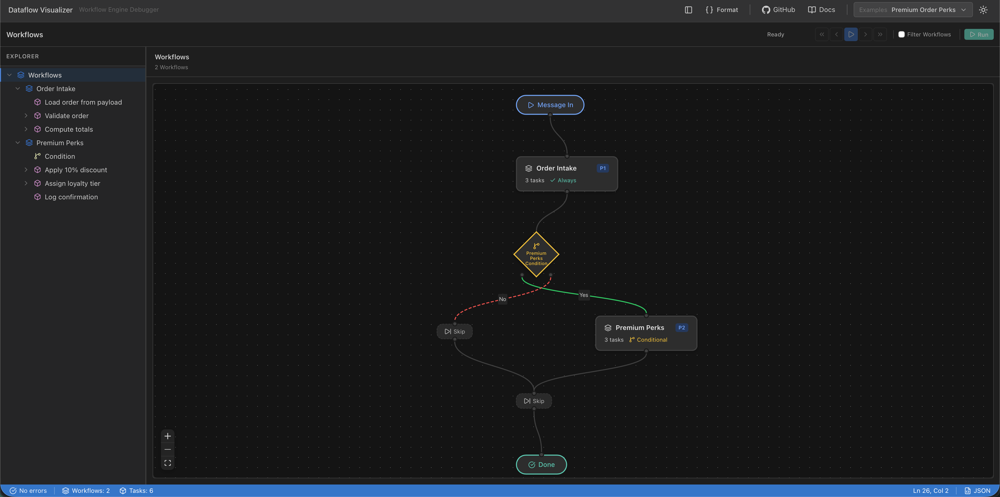
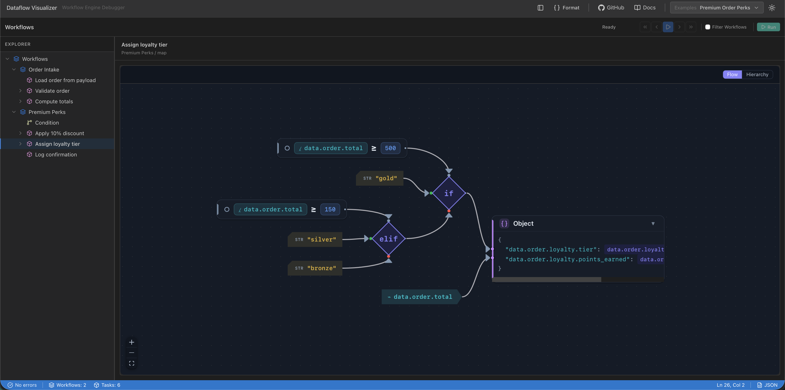

<div align="center">
  

  # Dataflow-rs

  **A high-performance rules engine for IFTTT-style automation in Rust with zero-overhead JSONLogic evaluation.**

  [](https://github.com/GoPlasmatic/dataflow-rs/actions/workflows/ci.yml)
  [](https://opensource.org/licenses/Apache-2.0)
  [](https://www.rust-lang.org)
  [](https://crates.io/crates/dataflow-rs)
  [](https://docs.rs/dataflow-rs)
  [](https://crates.io/crates/dataflow-rs)
</div>

---

<div align="center">
  <a href="https://goplasmatic.github.io/dataflow-rs/debugger/">
    
  </a>
  <p><em>Two chained rules in the visual debugger: <strong>IF</strong> the condition matches, <strong>THEN</strong> the next rule runs. <a href="https://goplasmatic.github.io/dataflow-rs/debugger/">Try it live in your browser →</a></em></p>
</div>

Dataflow-rs is a lightweight, embeddable rules engine that lets you define **IF → THEN → THAT** automation in JSON. The builder compiles every rule's JSONLogic once at build time, so runs skip parsing and execute host functions on Tokio. Use it to route events, validate data, or build multi-step automation pipelines.

### ⚡ Performance
Dataflow-rs targets high-throughput hot paths. The builder compiles every expression, task config, and write path once at build time. A run evaluates against one view of the message and reads the clock once.

In the 4.0 release gate against 3.15.0, the benchmark harness scored 16 of 49 metrics faster, 25 better, and 6 equal, while the two remaining metrics matched at seven rounds. `loop_scaling`, a 1000-sweep append loop over a large context, finished in 1 to 3% of 3.15's time. See [Performance](#performance) for the benchmark methodology and commands.

### 🧩 Full-Stack Ecosystem
Run the same rule definitions across your stack:
1.  **Rust Backend:** Run natively with high speed and concurrency using `dataflow-rs`.
2.  **Browser & Edge:** Run client-side validations or edge routing through the WebAssembly bindings in [@goplasmatic/dataflow-wasm](https://www.npmjs.com/package/@goplasmatic/dataflow-wasm).
3.  **React UI Admin Portal:** Let your team and your users visualize, edit, and step through rules with [@goplasmatic/dataflow-ui](https://www.npmjs.com/package/@goplasmatic/dataflow-ui).

## How It Works: IF → THEN → THAT

```text
┌─────────────────────────────────────────────────────────────────┐
│  Rule (Workflow)                                                │
│                                                                 │
│  IF    condition matches        →  JSONLogic against any field  │
│  THEN  execute actions (tasks)  →  map, validate, custom logic  │
│  THAT  chain more rules         →  priority-ordered execution   │
└─────────────────────────────────────────────────────────────────┘
```

**Example:** IF `order.total > 1000` THEN `apply_discount` AND `notify_manager`

## Core Concepts

| Term | In the API | Description |
|---|---|---|
| **Rule** | `WorkflowDef` | A condition plus a list of tasks: IF the condition holds, THEN the tasks run |
| **Action** | `TaskDef` | One processing step: a built-in (`map`, `validation`, ...) or a function you register |
| **Message** | `Message` | Input and state for a run: `payload`, a context of `data`, `metadata`, and `temp_data`, an audit trail, and an error list |
| **Engine** | `Engine` | Compiled rules plus registered functions; `run` takes a message through matching rules |
| **Run** | `Run` | Report for one execution: status, per-rule records, and an optional trace |

## Why dataflow-rs?

Dynamic business rules and user-customizable workflows outgrow hardcoded `if/else` branches, while distributed orchestrators (like Temporal or Zeebe) add infrastructure and network latency. Dataflow-rs sits between the two:

| Capability | Hardcoded Rust | dataflow-rs | Heavy Orchestrators (Temporal/Zeebe) |
|---|---|---|---|
| **Hot Reload Rules** | Recompile & redeploy | **Compile the new JSON, swap the program** | Deploy new worker code |
| **Execution Overhead** | None | **Zero (pre-compiled JSONLogic)** | DB reads/writes (tens of ms) |
| **Browser Execution** | Compile full app to WASM | **Run same rules in JS via WASM** | Network round-trip required |
| **Visual Debugger** | Build your own UI | **Included React UI components** | Included dashboard |
| **Infrastructure** | None | **None (embeddable library)** | Requires server clusters & DBs |

## Getting Started

### 1. Add to `Cargo.toml`

```toml
[dependencies]
dataflow-rs = "4.0"
tokio = { version = "1", features = ["rt-multi-thread", "macros"] }
serde_json = "1.0"
```

JSONLogic's extended operator families are opt-in at runtime on
`ExprEngineBuilder`; `ExprEngine::default()` enables core JSONLogic only.
Read [JSONLogic → Operator Families](docs/src/advanced/jsonlogic.md)
before enabling a family: turning one on can change how an existing rule behaves.

### 2. Define Rules in JSON

A message arrives with its body in `payload`. The engine evaluates conditions
and mappings against `data`, so the first rule loads the payload into `data`,
and the second rule acts on it. **Chaining**, the THAT in IF → THEN → THAT,
means rules run in order and each one sees what the previous rules wrote.

```json
{
    "id": "order_intake",
    "name": "Order Intake",
    "tasks": [
        {
            "id": "load_order",
            "function": {
                "name": "parse_json",
                "input": {"source": "payload", "target": "order"}
            }
        }
    ]
}
```

```json
{
    "id": "premium_order",
    "name": "Premium Order Processing",
    "condition": {">=": [{"var": "data.order.total"}, 1000]},
    "tasks": [
        {
            "id": "apply_discount",
            "function": {
                "name": "map",
                "input": {
                    "mappings": [
                        {
                            "path": "data.order.discount",
                            "logic": {"*": [{"var": "data.order.total"}, 0.1]}
                        }
                    ]
                }
            }
        }
    ]
}
```

> **The engine evaluates a rule's condition before running its tasks.** A
> condition reads what earlier rules produced, not what its own tasks will
> write. Place `parse_json` in an earlier rule so `premium_order` can check
> the parsed fields in its condition.

### 3. Run the Engine

```rust
use dataflow_rs::run::RunStatus;
use dataflow_rs::{Engine, Message};
use serde_json::{Value, json};

#[tokio::main]
async fn main() -> Result<(), Box<dyn std::error::Error>> {
    // Rule 1 from Step 2: always runs, moves the payload into `data.order`.
    let intake = json!({
        "id": "order_intake",
        "name": "Order Intake",
        "tasks": [{
            "id": "load_order",
            "function": {"name": "parse_json", "input": {"source": "payload", "target": "order"}}
        }]
    });

    // Rule 2 from Step 2: runs only when the condition matches.
    let premium = json!({
        "id": "premium_order",
        "name": "Premium Order Processing",
        "condition": {">=": [{"var": "data.order.total"}, 1000]},
        "tasks": [{
            "id": "apply_discount",
            "function": {"name": "map", "input": {"mappings": [
                {"path": "data.order.discount", "logic": {"*": [{"var": "data.order.total"}, 0.1]}}
            ]}}
        }]
    });

    // Build the engine: every expression compiles here. A definition that
    // does not compile is refused with its issues, each at the path the
    // author typed, so nothing fails on the first message.
    let engine = Engine::builder()
        .workflow_json(&intake)
        .workflow_json(&premium)
        .build()
        .map_err(|issues| format!("definitions rejected: {issues:#?}"))?;

    // Run a message. `from_json` sets the *payload*; `parse_json` in the
    // first rule is what lands it in `data`.
    let mut message = Message::from_json(&json!({"total": 1500}));
    let run = engine.run(&mut message).await;

    assert!(matches!(run.status(), RunStatus::Completed));
    assert_eq!(run.matched(), 2); // both rules ran

    let data = Value::from(message.context().data());
    assert_eq!(data["order"]["discount"].as_f64(), Some(150.0));
    println!("Discount: {}", data["order"]["discount"]); // 150
    Ok(())
}
```

`run` returns a `Run` for every outcome without short-circuiting. Pass
`RunOptions` to `run_with` when you need a channel, routing bucket, deadline,
cancellation token, trace, or per-run observer.

### Handling Errors: Two Channels

A run reports errors through **two channels**:

- `run.status()` reports how the run **ended**: `Completed`,
  `CompletedWithErrors` (rules finished, with error records on the message),
  `Stopped(error)` (a task failed and its policy stopped the run),
  `TimedOut`, or `Cancelled` (the run hit its deadline or cancellation token).
- `message.errors()` holds every error record, including errors from tasks
  whose policies allowed the run to continue.

Using `?` on `run.into_result()` surfaces only stopped, timed-out, or cancelled runs. Check both channels to handle all errors:

```rust
use dataflow_rs::run::RunStatus;
use dataflow_rs::{Engine, Message};
use serde_json::json;

#[tokio::main]
async fn main() -> Result<(), Box<dyn std::error::Error>> {
    // A failing `validation` returns 400: a rejection, recorded on the
    // message. Its default `on_rejection: continue` lets the run go on.
    let engine = Engine::builder()
        .workflow_json(&json!({
            "id": "intake",
            "tasks": [{
                "id": "check",
                "function": {"name": "validation", "input": {"rules": [
                    {"logic": {"==": [{"var": "data.ok"}, true]}, "message": "not ok"}
                ]}}
            }]
        }))
        .build()
        .map_err(|issues| format!("{issues:#?}"))?;

    let mut message = Message::from_json(&json!(null));
    let run = engine.run(&mut message).await;

    // Channel 1: how the run ended.
    match run.status() {
        RunStatus::Completed => println!("clean"),
        RunStatus::CompletedWithErrors => println!("finished; see message.errors()"),
        RunStatus::Stopped(e) => println!("stopped: {} ({})", e.message(), e.code()),
        RunStatus::TimedOut => println!("the run's deadline passed"),
        RunStatus::Cancelled => println!("the run's token was cancelled"),
        _ => {}
    }
    assert!(matches!(run.status(), RunStatus::CompletedWithErrors));

    // Channel 2: every record, whether or not it stopped anything.
    for err in message.errors() {
        println!("[{}] {}", err.code, err.message); // [VALIDATION_ERROR] not ok
    }
    assert_eq!(message.errors()[0].code, "VALIDATION_ERROR");
    Ok(())
}
```

Task policies control what happens after each outcome. A `4xx` status is a
**rejection**, governed by `on_rejection`: `"continue"` (default) or `"halt"`.
A `5xx` status or `Err` is a **failure**, governed by `on_failure`: `"fail"`
(default, which delegates to the workflow's `on_failure` of `"fail"` or
`"continue"`), `"halt"` (stops the workflow and continues the run), or
`"continue"`. Because `validation` returns `400` on failure, it continues to
the next task unless you set `"on_rejection": "halt"`. See the
[error handling guide](docs/src/core-concepts/error-handling.md).

### Branching on Task Failures

Both error channels live on the host side. Rule conditions evaluate against
`data`, `metadata`, and `temp_data`, which do not include `message.errors()`.
Configure an `ErrorContext` path and the engine mirrors each failure's code into
the context as it occurs:

```rust
use dataflow_rs::run::{EngineConfig, ErrorContext};
use dataflow_rs::{Engine, Message};
use serde_json::{Value, json};

#[tokio::main]
async fn main() -> Result<(), Box<dyn std::error::Error>> {
    let errors = ErrorContext::new("metadata.errors".parse()?, 32)?;
    let engine = Engine::builder()
        .config(EngineConfig::default().error_context(errors))
        .workflow_json(&json!({
            "id": "ingest",
            "tasks": [{
                "id": "parse",
                "on_failure": "continue",
                "function": {"name": "parse_xml", "input": {"source": "data.xml", "target": "doc"}}
            }]
        }))
        .build()
        .map_err(|issues| format!("{issues:#?}"))?;

    let mut message = Message::from_json(&json!(null));
    engine.run(&mut message).await;

    let metadata = Value::from(message.context().metadata());
    assert_eq!(metadata["errors"][0]["code"], "VALIDATION_ERROR");
    assert_eq!(metadata["errors"][0]["task_id"], "parse");
    Ok(())
}
```

Each record is `{workflow_id, task_id, code, status}`, so a later rule can treat
a transient failure differently from a permanent one:

```json
{"in": [{"var": "metadata.errors.0.code"}, ["TIMEOUT_ERROR", "IO_ERROR"]]}
```

The engine writes to this path only when configured and resets it at the start
of each run. The mirrored records omit the error message text because callers
receive the serialized context.

### Classifying Your Own Errors

Built-in error kinds cover engine concerns such as a missing function, a failed
evaluation, or an invalid path. When a function fails for a service-specific
reason (an open circuit breaker or a tenant rate limit), classify it with
`Error::service`:

```rust
use dataflow_rs::Error;

let e = Error::service("circuit_open", "upstream unavailable").with_retryable(true);
assert_eq!(e.code(), "circuit_open");
assert!(e.is_retryable());
```

The engine preserves your `code` string without changing its case and reads the
`retryable` flag you set. Task `on_failure` policies, audit entries, and
`Run::status` handle service errors like any other failure, while
`Run::retryable` returns the flag you declared.

## Key Features

- **IF → THEN → THAT Model:** Define rules with JSONLogic conditions, execute actions, and chain workflows in priority order.
- **Compile at Build:** The builder compiles every expression, task config, and write path once and rejects invalid definitions with their authored paths.
- **Complete Run Reports:** `run` returns a `Run` whether execution completed, stopped, timed out, or was cancelled, preserving the message and trace.
- **Full Context Access:** Conditions read any field in `data`, `metadata`, and `temp_data`.
- **Isolated Secrets:** `{"secret": "name"}` reads an engine-scoped store that stays out of traces, audit entries, and serialized messages. `build()` rejects workflows that would write a secret into the message.
- **Async Host Functions:** Host functions are `async fn` on Tokio; the eight built-in functions run inline.
- **Tracing and Observability:** `TraceOptions` records per-step changes that replay to reconstruct the context at any step, bounded by a byte budget and path redaction. `Observer` receives inline task events and reads the clock only when `Interest::TIMINGS` is set.
- **Built-in Functions:** Parse, Map, Validate, Filter, Log, and Publish.
- **Outcome Policies:** Configure `on_failure` and `on_rejection` per task, `on_failure` per workflow, `terminal` tasks, and task groups sharing a condition.
- **Loops and Fan-Outs:** Workflow `loop` runs a task list for a bounded number of sweeps. Task `for_each` calls a host function per array element in isolation and folds results in element order at any `max_concurrency`.
- **Deadlines and Cancellation:** `RunOptions::deadline` and `CancelToken` end a run as `TimedOut` or `Cancelled`, returning the partial message and trace.
- **Routing and Rollout:** Route by channel, split traffic by bucket range, and manage workflow `status` (`active`, `paused`, `archived`), version, and tags.
- **Hot Reload:** Compile new definitions with `engine.compiler()` and swap the program with `with_program` while in-flight runs finish on the old program.
- **Extensible:** Implement `Function` with `#[derive(FunctionConfig)]`, wrap host calls in a `CallLayer`, and unit-test individual calls with `function::testing::call`.
- **Service-Classified Errors:** Attach custom error codes and retryability with `Error::service`, and mirror failure codes into the context with `ErrorContext`.
- **3.x Compatibility:** The compat reader rewrites 3.x spellings into 4.0 format and reports each as an Advisory; see [Migrating from 3.x](#migrating-from-3x).
- **Browser and UI:** Run rules in the browser with `@goplasmatic/dataflow-wasm` and debug them with `@goplasmatic/dataflow-ui`.
- **Auditing:** Record an audit trail of context changes as data moves through the pipeline.

## Architecture

**Compilation (startup).** `def::parse` reads each definition, rewrites 3.x
spellings, and reports issues at their authored paths. `Compiler` compiles each
workflow against a `Registry` (expressions, task configs, write paths), so you
can quarantine invalid workflows and keep valid ones. `link` sorts compiled
workflows by priority into an immutable `Program`. `Engine::builder().build()`
runs all three steps and fails if any workflow is rejected.

**Execution (runtime).** `run` stamps the message and evaluates active
workflows in priority order, checking rollout and then condition. Built-in
functions run inline over one view of the context. Host functions receive a
`Ctx` whose writes apply on `Ok` and drop on `Err`. After each non-skipped
call, the engine updates `metadata.progress` so later rules can inspect what
ran. `Run` reports the final status and per-workflow results, `Observer`
receives inline events, and `Trace` records step diffs when requested.

## Performance

Key design choices keep per-message overhead low:
- **Compile at Build:** The builder compiles expressions, folds constants, and pre-splits write paths ahead of time, so a run does no parsing.
- **One View per Run:** Built-in tasks evaluate against a single arena view of the context and splice writes in place.
- **Overlay Writes:** Host function writes land in a per-call overlay that the function can read immediately; the engine replays them into the context when the call returns `Ok`.
- **Zero-Cost When Unwatched:** A run reads the clock once. Observer and trace work runs only when attached; the unwatched path adds a single branch per call.
- **Async I/O:** Host functions run on Tokio without blocking, and fan-outs run calls concurrently without spawning tasks.

In the 4.0 release gate against 3.15.0, 16 of 49 metrics scored faster, 25
better, and 6 equal, while the two `micro_subtree_write_bench` rows matched at
seven rounds. `loop_scaling` ran in 1 to 3% of 3.15's time. `bench/gate.py`
compares a base commit against a candidate by alternating both builds within
each round and judging the median per-round ratio against a noise floor of 3%
or half the inter-quartile range.

**Tuning tip:** If you do not read audit trails, pass
`RunOptions::default().capture_changes(false)` or keep only recent entries
with `.audit(AuditMode::Last(n))`. Skipping per-write old and new value copies
gives the largest savings in mapping-heavy and looping workflows. See the
[performance guide](docs/src/advanced/performance.md).

Run benchmarks with `--release`. The crate includes thirteen benchmark examples
(listed in [CONTRIBUTING.md](CONTRIBUTING.md#benchmarks)), and each verifies
its output before timing:

```bash
cargo run --example benchmark --release                # Throughput + latency percentiles
cargo run --example realistic_benchmark --release      # ISO 20022 -> SwiftMT-style workload
cargo run --example loop_scaling --release             # 1000-sweep append loop over a large context
cargo run --example async_handler_benchmark --release  # Marginal cost of one host function call
```

Runs vary by 2 to 3%. Compare the mean of three or more interleaved A/B runs.

## Custom Functions

Extend the engine with your own async actions. A function declares a typed
`Config`, compiled once when the engine is built, receives a `Ctx` whose
writes record audit-trail changes for you, and returns an `Outcome`:

```rust
use dataflow_rs::datavalue::OwnedDataValue;
use dataflow_rs::expr::Output;
use dataflow_rs::function::{FunctionConfig, testing};
use dataflow_rs::run::RunStatus;
use dataflow_rs::{Ctx, Engine, Expr, Function, Message, Outcome, Result};
use serde_json::{Value, json};

/// The task's `input`, compiled once when the engine is built. A malformed
/// one is refused there, with an issue at its key, not on the first message.
#[derive(FunctionConfig)]
struct NotifyConfig {
    /// Authored as a literal or as JSONLogic over the message.
    channel: Expr<String>,
    /// Where the result is written. The author may override the default.
    #[output(default = "data.notification")]
    output: Output,
}

struct NotifyManager;

impl Function for NotifyManager {
    type Config = NotifyConfig;

    async fn call(&self, ctx: &mut Ctx<'_>, cfg: &NotifyConfig) -> Result<Outcome> {
        let channel = ctx.eval(&cfg.channel)?;
        // Your async work here: an HTTP call, a queue write, ...
        let receipt = OwnedDataValue::from(&json!({"channel": &*channel, "sent": true}));
        ctx.emit_default(receipt)?; // writes through `output`
        Ok(Outcome::Ok)
    }
}

#[tokio::main]
async fn main() -> std::result::Result<(), Box<dyn std::error::Error>> {
    // Register functions on the builder; a task names one by its registered name.
    let engine = Engine::builder()
        .register("notify_manager", NotifyManager)
        .workflow_json(&json!({
            "id": "notify",
            "tasks": [{
                "id": "tell_manager",
                "function": {"name": "notify_manager", "input": {
                    "channel": {"cat": ["orders-", {"var": "data.region"}]}
                }}
            }]
        }))
        .build()
        .map_err(|issues| format!("{issues:#?}"))?;

    let mut message = Message::from_parts(
        OwnedDataValue::Null,
        OwnedDataValue::from(&json!({"region": "eu"})),
        OwnedDataValue::Null,
    );
    let run = engine.run(&mut message).await;
    assert!(matches!(run.status(), RunStatus::Completed));
    let data = Value::from(message.context().data());
    assert_eq!(data["notification"]["channel"], "orders-eu");

    // Unit-test one call without a workflow: the config compiles as a
    // workflow would compile it, and the call settles as a run settles it.
    let called = testing::call(NotifyManager, json!({"channel": "orders"})).await;
    assert_eq!(called.outcome?, Outcome::Ok);
    assert_eq!(called.writes.len(), 1); // one write, at `data.notification`
    Ok(())
}
```

`Outcome::Ok` records status `200`; `Outcome::Status(n)` records `n`, a `4xx`
being a rejection and a `5xx` a failure for the task's policies; `Skip`
records no entry; `Halt` records `299` and ends the rest of the workflow. A
call's writes reach the message only when it returns `Ok`: an `Err` drops them
whole, so a function never leaves a half-written message behind.

Every config field is JSONLogic, and the static spelling is free: a JSON
literal *is* JSONLogic for itself, so `"channel": "orders"` folds to a
constant at build time and costs nothing per message. `Expr<T>` is a field
the function evaluates (`T` fixes the result type), `Output` a destination it
writes through, and `#[config(default = ...)]` an authored default. One catch:
a single-key object whose key names an operator is that operator, so write
`{"$cat": ...}` for the literal object. See
[Custom Functions](docs/src/advanced/custom-functions.md) and
[Literal keys and the `$` escape](docs/src/advanced/jsonlogic.md).

## Built-in Functions

| Function | Purpose | Modifies Data |
|----------|---------|---------------|
| `parse_json` | Parse JSON from payload into data context | Yes |
| `parse_xml` | Parse XML string into JSON data structure | Yes |
| `map` | Data transformation using JSONLogic | Yes |
| `validation` | Rule-based data validation | No (read-only) |
| `filter` | Pipeline control flow: halt workflow or skip task | No |
| `log` | Structured logging with JSONLogic expressions | No |
| `publish_json` | Serialize data to JSON string | Yes |
| `publish_xml` | Serialize data to XML string | Yes |

The eight run inline, on the run's own view of the context, so a task calling
one cannot carry `for_each`; their names are reserved.

### Filter (Pipeline Control Flow)

The `filter` function evaluates a JSONLogic condition and controls pipeline execution:

```json
{
    "function": {
        "name": "filter",
        "input": {
            "condition": {"==": [{"var": "data.status"}, "active"]},
            "on_reject": "halt"
        }
    }
}
```

- `on_reject: "halt"` stops the entire workflow when the condition is false
- `on_reject: "skip"` skips only the current task and continues

### Log (Structured Logging)

The `log` function outputs structured log messages using the `log` crate:

```json
{
    "function": {
        "name": "log",
        "input": {
            "level": "info",
            "message": {"cat": ["Processing order ", {"var": "data.order.id"}]},
            "fields": {
                "total": {"var": "data.order.total"},
                "user": {"var": "data.user.name"}
            }
        }
    }
}
```

Log levels: `trace`, `debug`, `info`, `warn`, `error`. Messages and fields support JSONLogic expressions.

## Channel Routing

Workflows name a channel (`{ "id": "order_rule", "channel": "orders", ... }`),
and a run can take only that channel's workflows:

```rust
use dataflow_rs::{Engine, Message, Run, RunOptions};

/// Runs only the Active workflows of the `orders` channel.
async fn run_orders(engine: &Engine, message: &mut Message) -> Run {
    let opts = RunOptions::default().channel("orders");
    engine.run_with(message, &opts).await
}
```

Only `active` workflows run, with or without a channel. Workflows default to
the `"default"` channel, and the run stamps `metadata.channel` when it was
started on one.

## Workflow Lifecycle

Workflows support lifecycle management fields:

```jsonc
{
    "id": "my_rule",
    "channel": "orders",
    "version": 2,
    "status": "active",
    "tags": ["premium", "high-priority"],
    "created_at": "2025-01-15T10:00:00Z",
    "updated_at": "2025-06-01T14:30:00Z",
    "tasks": [...]
}
```

| Field | Type | Default | Description |
|-------|------|---------|-------------|
| `priority` | number | `0` | Run order: lower runs first, equal priorities keep their order |
| `channel` | string | `"default"` | Channel for message routing |
| `version` | number | `1` | Workflow version |
| `status` | string | `"active"` | `active`, `paused`, or `archived` |
| `tags` | array | `[]` | Arbitrary tags for organization |
| `rollout` | object | `null` | Traffic split: `{bucket_start, bucket_end}` over `0..100` |
| `created_at` | datetime | `null` | Creation timestamp (ISO 8601) |
| `updated_at` | datetime | `null` | Last update timestamp (ISO 8601) |

All fields are optional. Unknown keys move into the node's `ext` map and produce an issue report.

## Traffic Splits (Canary Rollouts)

Give a workflow a slice of its channel's traffic with a half-open bucket range
over `0..100`, so a new version can roll out gradually alongside the old one:

```jsonc
{
    "id": "checkout_v2",
    "channel": "checkout",
    "rollout": { "bucket_start": 0, "bucket_end": 10 },
    "tasks": [...]
}
```

That workflow serves buckets `0..=9`, 10% of traffic. `bucket_start` is
inclusive and `bucket_end` exclusive, so a `{"bucket_start": 10, "bucket_end": 100}`
sibling covers the remaining 90% with no overlap and no gap.

The engine does not derive the bucket. Set it per run with your own policy
(a sticky hash of a user id, a random draw, round-robin):

```rust
use dataflow_rs::{Engine, Message, Run, RunOptions};

async fn run_checkout(engine: &Engine, message: &mut Message, bucket: u8) -> Run {
    let opts = RunOptions::default().channel("checkout").routing_bucket(bucket);
    engine.run_with(message, &opts).await
}
```

Every workflow, split or not, admits a run with no bucket, so every caller
that predates rollouts keeps working unchanged. The engine skips an excluded
workflow before any other per-message work, and the `Run` records it as
`SkippedByRollout`.

## Secrets

A signing key or partner token has to be readable by a condition and must never
appear in a trace. The message context cannot express that, because everything
in it is recorded. Secrets therefore live in a store on the expression engine,
and expressions read them through one reserved operator:

```rust
use dataflow_rs::datavalue::OwnedDataValue;
use dataflow_rs::expr::{ExprEngine, Secrets};
use dataflow_rs::{Engine, Registry};
use serde_json::json;

fn build_engine() -> Result<Engine, Box<dyn std::error::Error>> {
    let store = Secrets::new(OwnedDataValue::from(&json!({
        "webhook_token": std::env::var("WEBHOOK_TOKEN").unwrap_or_default()
    })))?;
    let exprs = ExprEngine::builder().secrets(store).build()?;

    Engine::builder()
        .registry(Registry::new(exprs))
        .workflow_json(&json!({
            "id": "webhook",
            "condition": {"==": [{"var": "metadata.headers.x-token"}, {"secret": "webhook_token"}]},
            "tasks": [{"id": "accept", "function": {"name": "map", "input": {"mappings": [
                {"path": "data.accepted", "logic": true}
            ]}}}]
        }))
        .build()
        .map_err(|issues| format!("{issues:#?}").into())
}
```

The value never enters a `Message`, so it cannot appear in anything derived
from one. `build()` refuses a `map` mapping or `log` expression that reads a
secret (`SECRET_IN_MESSAGE_WRITE`), and a name the store does not declare
(`UNKNOWN_SECRET`). A host function reads one through `Ctx::secret` or an
`Expr` field, and a layer's view of its config shows that field as `null`.
Derived values such as an HMAC belong in such a function. See the
[Secrets](docs/src/advanced/secrets.md) page.

## Reloading Definitions

An `Engine` is a program plus its config, behind an `Arc`. To reload, compile
the new definitions with the engine's own compiler, which shares its
functions, operators and secrets, and swap the program:

```rust
use dataflow_rs::Engine;
use dataflow_rs::def::{ParseOptions, parse};
use serde_json::Value;

/// An engine running `definition` in place of this one's program. `engine`
/// is unchanged, and keeps serving any message in flight.
fn reload(engine: &Engine, definition: &Value) -> Result<Engine, Box<dyn std::error::Error>> {
    let compiler = engine.compiler();
    let parsed = parse(definition, ParseOptions::default());
    let def = parsed.def.ok_or_else(|| format!("rejected: {:#?}", parsed.issues))?;
    let compiled = compiler.compile_one(&def).map_err(|issues| format!("{issues:#?}"))?;
    Ok(engine.with_program(compiler.link([compiled.workflow])))
}
```

Each workflow compiles on its own, so a host that quarantines keeps the ones
that compile and reports the rest. `Compiler::check` gives every issue of a
definition, Advisories included, for an editor's pre-save screen.

## Execution Tracing & Observability

Ask a run for a trace and the `Run` carries one: the context after the run's
stamps, then one step per call, skip and failure with the changes it made.
Replaying the changes gives the context after every step, so a trace is a
step debugger's input without a message snapshot per task. `TraceOptions`
bound it up front: timings, changes, path redaction and a byte budget.

```rust
use dataflow_rs::observe::TraceOptions;
use dataflow_rs::{Engine, Message, RunOptions};

async fn inspect(engine: &Engine, message: &mut Message) -> Result<(), Box<dyn std::error::Error>> {
    let opts = RunOptions::default().trace(TraceOptions::default().timings(true));
    let run = engine.run_with(message, &opts).await;

    let trace = run.trace().ok_or("the run was traced")?;
    for step in &trace.steps {
        println!("{}/{:?}: {:?} in {:?}", step.workflow_id, step.task_id, step.result, step.elapsed);
    }

    // The context after each step, replayed from `trace.initial`. The last one
    // is the message's context, on every status, unless the byte budget was
    // crossed (`trace.truncated`).
    let after_last = trace.contexts().last();
    assert_eq!(after_last.as_ref(), Some(message.context()));
    Ok(())
}
```

For always-on aggregation instead of a per-request trace, attach an
`Observer`. It is called inline, once per task, built-ins included, and its
`Interest` says which events it wants: without `TIMINGS` no clock is read.

```rust
use dataflow_rs::observe::{Event, Interest, Observer};
use dataflow_rs::run::EngineConfig;
use dataflow_rs::{Engine, Issue};
use serde_json::Value;
use std::sync::Arc;
use std::sync::atomic::{AtomicU64, Ordering};

#[derive(Default)]
struct Metrics {
    calls: AtomicU64,
}

impl Observer for Metrics {
    fn interest(&self) -> Interest {
        Interest::TASKS | Interest::TIMINGS
    }

    fn on(&self, event: &Event<'_>) {
        // Runs synchronously on the run: must be cheap and non-blocking.
        if let Event::TaskFinished { info, elapsed, .. } = event {
            self.calls.fetch_add(1, Ordering::Relaxed);
            let _ = (info.function, elapsed); // feed a histogram here
        }
    }
}

/// An engine over `definitions` that reports every run to `metrics`.
fn build(definitions: &[Value], metrics: Arc<Metrics>) -> Result<Engine, Vec<Issue>> {
    let builder = Engine::builder().config(EngineConfig::default().observer(metrics));
    definitions.iter().fold(builder, |b, d| b.workflow_json(d)).build()
}
```

`RunOptions::observer` attaches one to a single run instead. With neither an
observer nor a trace attached, their costs, clock reads included, stay out of
the dispatch path.

## Visualize & Debug Rules

Because every rule is plain JSON, the [React UI](https://www.npmjs.com/package/@goplasmatic/dataflow-ui) can render it: JSONLogic expressions become readable flow diagrams, and the debugger runs a message through the engine and steps through its trace, rebuilding the context after every task from the trace's changes. A run that stops shows its status and the step that failed.

<div align="center">
  <a href="https://goplasmatic.github.io/dataflow-rs/debugger/">
    
  </a>
</div>

## Ecosystem

| Package | Description | Install |
|---------|-------------|-------|
| [dataflow-rs](https://crates.io/crates/dataflow-rs) | The rules engine in Rust (this crate) | `cargo add dataflow-rs` |
| [@goplasmatic/dataflow-wasm](https://www.npmjs.com/package/@goplasmatic/dataflow-wasm) | The engine for the browser and Node: one `WasmEngine`, whose `run(payload, options)` resolves with the message, the run and a trace on every status, typed end to end | `npm i @goplasmatic/dataflow-wasm` |
| [@goplasmatic/dataflow-ui](https://www.npmjs.com/package/@goplasmatic/dataflow-ui) | React components for rule visualization, editing, and step-by-step debugging over the engine's traces | `npm i @goplasmatic/dataflow-ui` |
| [datalogic-rs](https://crates.io/crates/datalogic-rs) | JSONLogic compiler/evaluator used internally | `cargo add datalogic-rs` |

📖 **Documentation:** [User Guide & API Reference](https://goplasmatic.github.io/dataflow-rs/) · [Interactive Playground](https://goplasmatic.github.io/dataflow-rs/playground.html) · [Visual Debugger](https://goplasmatic.github.io/dataflow-rs/debugger/)

## Migrating from 3.x

Existing 3.x definitions load through the compat reader, which is enabled by
default. The reader rewrites 3.x spellings into 4.0 equivalents
(`continue_on_error` and `halt_on` into `on_failure` and `on_rejection`, and
`validate` into `validation`) and reports each as a `V3_SPELLING` Advisory at
the 3.x key. `dataflow_rs::compat::migrate_v3` writes a definition out in the
4.0 format. In the Rust API, `Engine::run` returns a `Run` on every status in
place of the `process_message` family, host functions implement `Function` with
`#[derive(FunctionConfig)]` in place of `AsyncFunctionHandler` and
`TaskContext`, `Outcome` replaces `TaskOutcome`, `Error` replaces
`DataflowError`, and `Message::from_json` or `Message::from_parts` replaces
`Message::builder`. Wire formats for `Message`, audit trails, and error records
match 3.x. See [Migrating from 3.x](docs/src/migration/from-3.md).

## Contributing

Contributions are welcome:

1. **Fork** the repository and clone your fork
2. **Run tests:** `cargo test --workspace --all-features` (what CI runs) and `cargo test` at the root (the default feature set)
3. **Make changes** and add tests for new features
4. **Run the benchmarks** before and after: `cargo run --example benchmark --release`, interleaving the two builds
5. **Submit a pull request** describing your changes

See [CONTRIBUTING.md](CONTRIBUTING.md) for the CI checks and [CHANGELOG](CHANGELOG.md) for release history.

## About Plasmatic

The [Plasmatic](https://github.com/GoPlasmatic) team develops dataflow-rs and builds open-source tools for data processing and automation.

## License

Apache License, Version 2.0. See [LICENSE](LICENSE).
